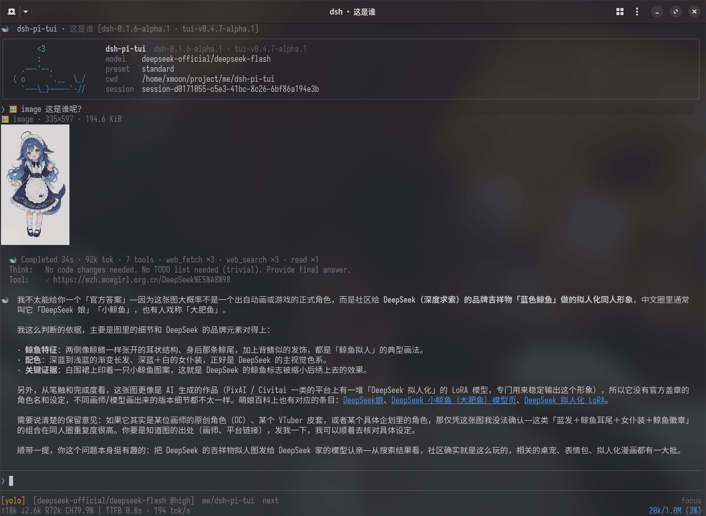

# dsh-pi-tui

[简体中文](README.md) | English

[](https://www.npmjs.com/package/@xmoon76/dsh-pi-tui)
[](LICENSE)

A Pi-style terminal frontend for [DeepSeek Harness](https://github.com/deepseek-ai/deepseek-harness).

`dsh-pi-tui` is installed as an independent dsh bundle inside a profile. It provides terminal interaction for streaming conversations, tool calls, session management, subagents, history search, shell commands, approvals, and settings. Models, tools, Sessions, permissions, Skills, Plan, Goal, and Subagent runtime behavior are still provided by DeepSeek Harness.



## Install into a DSH profile

### Stable / latest

Stable releases are recommended for ordinary users. Install DSH first, then add
the TUI to the `pi-tui` profile:

```sh
npm install -g --allow-scripts=@deepseek-ai/dsh-subprocess-local,koffi,node-pty @deepseek-ai/dsh@latest
dsh plugin --profile pi-tui -- add @xmoon76/dsh-pi-tui@latest
dsh --profile pi-tui
```

### Next / npm line (validation)

Preview installation uses the DSH `alpha` channel and the TUI `next` channel.
The DSH native install scripts must be explicitly allowed:

```sh
npm install -g --allow-scripts=@deepseek-ai/dsh-subprocess-local,koffi,node-pty @deepseek-ai/dsh@alpha
dsh plugin --profile pi-tui -- add @xmoon76/dsh-pi-tui@next
dsh --profile pi-tui
```

> **Those two channels are not an installable compatible pair today.** They are
> channel pointers only: `@deepseek-ai/dsh@alpha` currently resolves to
> `0.2.1-alpha.5`, while `@xmoon76/dsh-pi-tui@next` still resolves to
> `0.5.2-rc.1` (peer floor `>=0.2.0-rc.2`, and npm semver excludes a
> different-major.minor.patch prerelease). Use the pairing table below and
> [compatibility guide](docs/guides/dsh-compatibility.md) for the matching rules; the
> stable `0.5.3` publishes to `@latest`, not `@next`, so no installable compatible
> combination exists on those two moving channels. Validate this exact checkout
> with `pnpm compat:dsh:npm`.

Use the isolated npm driver (it installs the exact DSH version declared by this
checkout and exercises the full build/test/package path):

```sh
pnpm compat:dsh:npm
```

See the [compatibility guide](docs/guides/dsh-compatibility.md) for the stable minimum,
next compatibility range, and fallback paths.

### Requirements

* DeepSeek Harness
* Node.js `^22.19.0 || >=24`

### DSH/TUI version pairing (important)

| TUI package line | Official DSH tags for the pairing | Notes |
|---|---|---|
| `0.5.3` (stable / `@latest`) | `dsh-v0.2.1-rc.2`, `dsh-v0.2.1-rc.3` | Current published stable line; the peer floor stays 0.2.1-rc.2, while this checkout's exact validation target has moved to 0.2.1-rc.3 |
| `0.5.1` (stable, previous) | `dsh-v0.2.0-rc.2` | Previous stable line; both the minimum and the exact validation target are the 0.2.0-rc.2 family |
| `0.5.2-rc.1` (published next-channel preview) | `dsh-v0.2.0-rc.2` | Previous next preview: published to the npm `next` dist-tag on 2026-10-17; its whole peer floor stays `>=0.2.0-rc.2`, so it does not cover 0.2.1-rc.2 |
| `dsh-v0.2.1-rc.1` (no paired TUI) | none | No released TUI in this matrix claims that intermediate release; never reuse `0.5.3` for it |
| `0.5.0` (stable, previous) | `dsh-v0.1.7-rc.2`, `dsh-v0.2.0-rc.1` | Previous stable; 0.1.7-rc.2 minimum, exact validation target 0.2.0-rc.1 |
| `0.4.9` (stable, previous) | `dsh-v0.1.7-rc.2` | Previous stable; the compatible TUI for a 0.1.7-rc.2 runtime |
| `0.4.8` (stable, previous) | `dsh-v0.1.7-rc.1` | Previous stable; the compatible TUI for a 0.1.7-rc.1 runtime |
| `0.4.6` (stable, previous) | `dsh-v0.1.5-rc.1`, `dsh-v0.1.5-rc.2` | Previous stable; the compatible TUI for a 0.1.5 runtime |
| `0.4.7-alpha.2` (next, previous) | `dsh-v0.1.6-alpha.2` | Previous next line; the compatible TUI for a 0.1.6-alpha.2 runtime |

Do not mix the stable and `@next` prerelease lines. `0.5.3` is the current
published stable release: its minimum DSH version (peer floor) stays the
`0.2.1-rc.2` family, and the published `0.5.3` has also been qualified
against the newer `dsh-v0.2.1-rc.3` target (the official preset assembly passes
on rc.3). This checkout's exact validation target has moved to `0.2.1-rc.3`,
which does not change the published `0.5.3` identity or its floor. The intermediate
`dsh-v0.2.1-rc.1` has no paired TUI, and `0.5.2-rc.1` is the previous preview
published to the npm `next` channel (its pairing, 0.2.0-rc.2, stays in the table
above; it does not cover 0.2.1-rc.2, which is why the new stable line uses the
`0.5.3` identity). The previous stable
`0.5.1` keeps pairing with 0.2.0-rc.2: it lifts the whole DSH peer floor to
`>=0.2.0-rc.2` (the Question lifecycle consumes contracts published only in
that rc.2 family). The previous stable `0.5.0`
line keeps its `>=0.1.7-rc.2` floor (exact validation target 0.2.0-rc.1);
older runtimes fail at the normal
incompatible-runtime boundary, so install the paired TUI line from the table
above. The startup notice
is best-effort rather than a Loader startup-order guarantee. The pairing table
above is the published-line summary; see the [compatibility
guide](docs/guides/dsh-compatibility.md) for general matching, fallback and
diagnosis, and the [latest `next`
README](https://github.com/XMoon/dsh-pi-tui/blob/next/README.md) for the current
integration status.

New agent sessions use the official roster's selected preset id. A custom DSH
preset literally named `code` is valid and remains `code` when it exists in the
current roster. DSH V3 migration owns historical session `code -> ptc`
conversion, while the current projection preserves a legal custom `code`. An
omitted legacy settings default is never aliased: with no matching declaration
in the current roster it is simply an invalid preference.

### Profile management

Update the installed TUI:

```sh
dsh plugin --profile pi-tui -- update @xmoon76/dsh-pi-tui
```

List installed plugins:

```sh
dsh plugin --profile pi-tui -- list
```

Remove the plugin:

```sh
dsh plugin --profile pi-tui -- remove @xmoon76/dsh-pi-tui
```

Resume an existing Session:

```sh
dsh --profile pi-tui --session <session-id>
```

## Features

### Conversation and tools

* Streaming Markdown output
* Collapsible Thinking blocks
* Tool Call cards with running / success / failure state
* Collapsible Tool / System details
* Full-text Transcript search
* Folding for long Session history
* Context, token, model, and runtime status
* Approval and `ask_user_question` dialogs
* Plan Review
* Todo / Goal status
* Human-readable terminal window titles
* Bounded long-session windows with stable paging and live-follow position
* Long user prompts collapse to head + marker + tail; `Ctrl+O` expands and collapses them in regular mode and in fullscreen outside Focus
* No duplicate ghost Tool Cards after compaction / pruning

`Ctrl+O` controls Tool and System details and expands/collapses long user prompts in regular mode and in fullscreen outside Focus — in fullscreen Focus it bulk-expands the recent Thought roots or collapses them all, while long user prompts are expanded by clicking the marker (or by a search hit) and collapsed with `Ctrl+O`. `Alt+T` controls Thinking separately.

### Conversation display

`/display` switches between three presentation presets: `full` (default) is the normal Transcript projection; `focus` groups the current turn's Thinking, Tool Calls, and intermediate replies into a live Thought block; `compact` folds contiguous process into `Activity` spans with Header + `Think:` / `Action:` previews, keeps the session and assistant intermediate output visible in chronological order, renders injected notice / relay / recall entries separately (adjacent environment injections merge into an expandable Context cluster), and expands with a mouse click or `Ctrl+O`. The `Display` row in `/settings` offers the same values and persists the choice; `/focus` remains available as a compatibility command.

The full process can still be expanded when needed. In fullscreen Focus, Thought roots can be expanded/collapsed in bulk or opened with an individual card click, and the viewport survives switches and resizes. Display presets only change presentation; they do not modify Session events.

### Communication policy

`/settings` exposes two independent communication controls. **Progress updates** owns the mid-turn update cadence: `milestones` (default) posts a brief update only when a substantial phase completes, the direction materially changes, or required user input blocks progress — never for a freshly discovered partial finding; `frequent` keeps the user actively informed through longer multi-step work; `off` suppresses progress narration entirely. **Response style** owns the visible answer's density: `default` adds no extra guidance, `concise` is compact and result-first, `explanatory` adds rationale, architecture, and tradeoffs. Changes apply on the next prompt assembly without restarting the agent and are saved across sessions. Focus is a surface capability, not a third preference: while Focus is active the progress section is simply ineffective (progress-only intermediate messages are not generated) and the saved cadence is untouched; the response style stays active in Focus.

### Sessions

Supports persisted DSH Sessions, including:

* Creating and resuming Sessions
* Session switching
* Renaming
* Forking
* Rewind
* Session lineage
* `/export` — full Session archive (descendants + attachments) saved to a Client-local directory
* `/transcript` — readable Markdown transcript saved to a Client-local directory

Use:

```text
/sessions
/fork
/rewind
/export
/transcript
```

When the Agent is idle and the editor is empty, pressing `Esc` twice quickly also opens Rewind.

Rewind creates a new Child Session from a selected historical User Turn and restores that Prompt into the editor. The original Session is left unchanged.

### Input history

`Ctrl+R` opens input history search.

Three scopes are available:

* Current session
* Current directory
* All directories

History results include the Prompt, working directory, timestamp, and Session information. Selecting an entry restores it to the editor without submitting it.

Regular `↑` / `↓` history recall is still available for recent input.

### Subagents and the Task Center

`/tasks` opens the full Task Center, showing the work the current Session's
Job Registry / Subagent catalog still tracks; the Footer's `↓` opens the
lightweight Quick Tasks view for the current active work. Selecting a Job opens
the fullscreen Job workspace: one status row with the Job identity, the themed
status and the `[GAP]`/`[ERROR]`/`[SETTLED]` facts, followed by the real
progress/detail, the command summary and the `Output` / `Command` reading tabs.
Output is the official non-consuming live preview (scrollable, searchable and
explicitly labelled as a retained tail rather than the full history), and the
Command page shows and copies the original shell command. It never consumes the
model's `job_output` cursor and never becomes session history.

Task Center is a live tracked/control projection, not an execution-history
list. `ACTIVE` / `TRACKED` are presentation scopes: `ACTIVE` shows only the
currently active items, `TRACKED` shows everything the current authority
still lists. DSH `0.1.7` temporarily registers a Job while an ordinary
foreground `bash` / `pwsh` command runs, so it can be observed and stopped
from the Task Center; if the command finishes inside the foreground wait,
DSH removes that temporary record and the final result stays in the
Transcript's tool card. Explicit `run_in_background: true` jobs (and jobs
promoted to the background after a foreground timeout) remain visible in
`TRACKED` after completion as long as the Job Registry keeps their record.

`/plugins` is a deep link into `/settings → Plugins`: both take the SAME
Settings fullscreen lease and the SAME Plugin Manager page — there is no
separate plugin screen and no Session create/switch. The catalog is grouped as
TUI & Extensions / Official DSH / Third-party / Experimental (the Experimental
group is always last). At >=120 columns, and only while the frame can grant six
real business-body rows, the frame shows
`Categories | Plugin List | Details`; a shorter frame degrades to the pair or one
column instead of squeezing the body. At 76-119 columns it shows
`Categories | List` or `List | Details` depending on the keyboard owner — the pair
again needs six real business-body rows, otherwise it degrades to one column; below
76 columns it is one column. Install, dangerous confirmations and Diagnostics
always take the full width so risk text is never squeezed. Settings paints the
shared header/metadata/rule/pane header and the single last-row action bar; the
plugin page contributes only its business body. Search, status filters,
provenance/status facts, official catalog installs, enablement and removal are
available from the page; the actual Host-reported version, restart requirement
and errors are shown verbatim. The `dsh-pi-tui` bundle currently providing the
surface is read-only and cannot be disabled or removed from its own screen. The
category preview and `/plugins` share one page instance and one background
install request: `Esc` from the List returns to the Settings category and a
second `Esc` closes the workspace. Press `d` inside the page
for the read-only **Diagnostics** view: extension contribution health grouped by
owner (`active/failed/shadowed` with the full `lastError`), live registry counts,
the actual advertised capabilities, and contributions with no proven Loader-entry
owner under `Unassociated extension contributions`. `c` copies the selected fact,
`C` copies everything, `r` rereads and Esc returns. Diagnostics reads only the
extension ledger; Host package state and install logs stay out of it. `copy`
still proves emission only, never an OS-clipboard receipt.

The 14 official rc.2 Experimental bundles carry a bounded, identity-exact
Detail statement of their terminal surface and limits/risks (Web-only,
Host-only, the B04 WEB_ONLY/Host-row-pending boundary accepted by the Owner,
and the B13/B14 verified one-shot/provider boundaries). That copy never follows
enablement and never claims a live Host capability PASS. Upgrade guidance is
derived from Host facts only: shipped bundles upgrade with the DSH installation,
profile-owned bundles require Remove followed by an explicit later install,
missing entries use the official on-demand target, and the Current TUI bundle
is managed outside the screen. There is no in-place update, version picker or
silent reinstall.

Subagents are shown using their complete lineage, including nested descendants:

```text
main
├─ subagent A
│  └─ subagent B
└─ subagent C
```

The browser distinguishes:

* `continuable`
* `one-shot`
* running / inactive
* nested descendants
* Job Registry rows (including running foreground shell work)

The Footer's `↓` opens Quick Tasks as a lightweight browsing view: it only
supports arrow navigation, left/right expand/collapse, `Tab` type cycling,
`Enter` open, and `Esc` close. The bottom “Open Task Center” row opens the full
Task Center.

The full Task Center additionally offers `A` to toggle Active / Tracked, `/` search,
`Tab` / `Shift+Tab` to cycle types in both directions, `S` to stop the selected
task after confirmation, and `R` to refresh/retry. Quick Tasks consumes only the
whitelist above; every other keystroke is a no-op that never enters search, stop
confirmation, or management state, so `Esc` always closes it in one layer.

Completed one-shot Subagents remain available for persisted Transcript inspection.

A direct `continuable` Child can be opened in an interactive viewer and sent follow-up messages directly (through DSH's official `subagents.prompt()` human channel — queued in order as the Child's own next turn, with user provenance). The Child has its own Transcript, Draft, and runtime state, without modifying the main Session input.

Deeper nested Subagents are read-only by default.

The official subagent model selection (the DSH `subagent-model-selection`
setting) can be toggled and its allowlist maintained in `/settings`: once
enabled, a NEW session's official `subagent` tool may pick the child
provider/model per call (bounded by the allowlist). The setting is sampled at
session composition and never rewrites the tools of an already-running
session.

### Shell

The editor supports two Shell modes:

```text
! git status
```

Runs the command in the Host environment and submits its output into the current Session.

```text
!! git status
```

Runs the command in the Host environment as well; its output stays out of model context (card display only).

`!` / `!!` are editor modes rather than plain text prefixes. The prompt and completion behavior switch together with the active mode.

Shell cards show a bounded output preview by default. `Ctrl+O` expands the retained output — except in fullscreen Focus, where Ctrl+O owns the Thought roots and the shell cards keep their folded state.

### Git commit attribution (optional)

When enabled, dsh-pi-tui instructs the Agent to add the official attribution trailers when it creates Git commits:

```text
Co-Authored-By: @xmoon76/dsh-pi-tui <dsh-pi-tui@xmoon.org>
```

It is **off by default**. Three modes are supported:

```text
off            no attribution guidance (default)
product        the official Co-Authored-By trailer
product-model  official trailer + Assisted-By: <provider>/<model>
```

This is **Agent guidance (a prompt policy), not repository-level enforcement**:
dsh-pi-tui installs no Git hooks, rewrites no `git commit` command, and probes
no repository. The `provider`/`model` in `product-model` come straight from
DSH's official model selection (a model switch takes effect on the next
request).

Boundaries:

- `!` / `!!` user shell commands and commits from your own terminal are completely untouched;
- no `prepare-commit-msg` hook is installed and existing hooks are never modified;
- **not effective under the `minimal` preset**: its persona is a complete system prompt
  (`complete: true`) that replaces every other section — the same existing behavior for the
  other TUI guidance (progress updates, response style, focus);
- no GitHub credentials or API are required; the Author/Committer identity is never modified;
- a model may in theory ignore or mis-transcribe the instruction — this is the accepted tradeoff: low-intrusion guidance instead of a full Git lifecycle subsystem.

### File references and images

Typing `@` opens workspace file search and completion:

```text
@src/index.ts
@"path with spaces/file.ts"
```

`/attach <path>` is the unified Client-local image/file intake; `/image <path>` keeps its image-only compatibility semantics. Both complete files and directories; paths with spaces, quotes, or Windows separators preserve the input dialect, and directories can be expanded further.

Resolvable relative paths are canonicalized before submission.

Clipboard images can be added with `Ctrl+V` and persisted through the DSH Attachment service.

### Models and runtime settings

The TUI uses DSH model and settings services.

Common entry points:

```text
/model
/settings
/status
/login
/permission
/plan
/goal
/compact
/footer
/statusline
```

Model selection, Reasoning Effort, permission presets, Plan, and Goal all keep the corresponding DSH runtime semantics. `/model` candidates come only from the Host catalog: rc.2's `deepseek-flash` is identified by the exact `(provider, model)` pair (the display name `DeepSeek-V4.1-Flash` is never the ID), and a selection writes the official Session/global default. A deployment catalog that no longer offers the ID shows no invented row.

`/settings` opens a real full-screen workspace where the three-, two- and
single-column layouts are projections of the SAME `categories → rows → detail`
levels: wide terminals show all three columns, medium ones show
`categories + rows` or `rows + details` for the current level, and narrow ones
show only the current level. At every width ASCII `Right` advances exactly one
level and `Left` returns one level (inert at L0); `Enter` follows the same
transitions, and `Esc`/`Backspace` step back, closing at the outermost level.
`Tab`/`Shift+Tab` remain inert. The Action Bar stays pinned to the last physical
row. Multi-column choosing retains the active `[Details]` marker unless that
heading would consume the only content row. It presents the real Appearance /
Display facts: the theme's source-qualified raw value plus its friendly name,
Icon style, the live Transcript display preset alongside the persisted preference,
the live Thinking detail state, and each row's configuration Scope and backend
readiness. `R`
re-reads. Browsing and choosing never write configuration. The ordinary
configuration detail is view-only: it offers no copy action and no replacement
copy entry. About's `c`/`C` copy About's own facts (runtime, Session identity,
statistics, performance and Context) and never a configuration field.

About's copy actions live on the keyboard: with a fact selected, `c` copies that
fact's exact raw value (the Action Bar advertises `c copy fact` only while the
fact is really painted), and `C` copies the whole About report to the clipboard.
The body carries at most one `Copy All [C]`; facts no longer get a `Copy [C]`
button and clicking an ordinary fact never copies. `Shift+C` works from the
category rail too. A copy still only proves the bytes were emitted to the local
clipboard delivery path, and never writes configuration.

`/status` is a real alias of `/settings`: the same handler, the same initial
About focus and the same reads; neither creates a session or reads statistics
while sessionless. `/statusline` remains the `/footer` alias and never goes
through Settings. The Settings categories are the fixed `About / Models / Account / Agent /
Appearance / Conversation / Input & Terminal / Tools / Plugins`, and `Extensions` is appended only
while the extension settings registry really has rows; `/settings` (and `/status`) land on About.
Adding, removing or same-id re-registering an extension row revokes the previous frame's keyboard
and pointer grants first, and only `Esc` can still return safely until that frame repaints. `Models` is an in-place page: it lists
the Host provider directory, whether an API key is configured (presence only, never a
connection test) and the DeepSeek Account entry; it exposes provider facts, a masked API-key
editor, the Add Provider draft wizard, and provider-native sign-in with a persistent notice,
prompts and cancel. `Account` is the independent DeepSeek Account page: it shows the Host state,
the browser authorization URL and SSH tunnel guidance, and independent Profile / recharge-wallet
/ bonus-wallet outcomes (a failure is never shown as a zero balance); it can cancel the exact
attempt, refresh, and sign out after an explicit confirmation. Closing the page does not cancel
an already-started browser sign-in. `/login` and `/logout` now only resolve a target and open the
corresponding page (`/login` opens Models, a known route opens its detail, a known/novel reference
opens the API Key Reference, a new route prefills Add Provider, and `deepseek-account` opens
Account; `/logout` opens the stored-credentials list or one clear confirmation). The final write
or clear always requires an explicit confirmation in the page. Account authorization stays
separate from generic provider flows: it signs in only through the official PlatformAccount and
the Host loopback `/oauth/callback`, and is never cleared as a generic credential record.

The **`Configured theme` and `Transcript display` rows are directly editable**:
from L1, `Right` or `Enter`, the painted `[Change…]` button, or ordinary visible
Detail content opens the candidate choice in the SAME L2 pane. Current-value and
Runtime/Persisted facts stay in the same pane above the candidate region and scroll
independently. `Up`/`Down`/`Home`/`End` move the candidate; `PgUp`/`PgDn` and the
wheel over facts scroll only the fact region, while the candidate wheel scrolls
independently. During choice the copy keys copy nothing and never commit the
draft candidate. `Enter`
or `[Confirm]` confirms explicitly, and `Left`/`Esc`/`Backspace` or `[Cancel]`
cancels directly to L1 without writing anything. If the selected candidate identity
has scrolled out of view, the first Enter only reveals it; confirmation requires a
later Enter. From L2 browse or a settled outcome, Enter reopens choice for a
writable non-pending row. At 44×8, a long identity may first reclaim the optional
`Choose value` heading; if still needed, the fact area shrinks only to one original
`Value` row. The complete identity, `Confirm` and `Enter confirm` must be visible
before a write.
An identity beyond the remaining candidate capacity stays unconfirmable. Only
buttons and candidates that are really painted can be clicked. A confirmed change is stored through the existing
serialized whole-document write path and then re-read from the authority: the
detail names the live runtime fact (`Runtime`, e.g. the current palette) and the
stored preference (`Persisted`) separately and states `Saving…`, `Verified`,
`Not saved · <reason>`, `Commit accepted · verification unavailable` or
`Outcome unknown · <reason>` — only a completed write whose authoritative
re-read agrees is called Verified; a rejected write re-reads the authority first
and reports Not saved only while it still carries the value the request started
from; a third value, a value already in place or an unreadable authority is
Outcome unknown, and a success whose readable readback disagrees is a failure
rather than "verification unavailable". On a non-ready backend the theme is
neither applied nor written; a display preset may already be live locally and
then says that it was not stored instead of pretending it was. A plugin theme is
resolved again by its source-qualified identity at confirm time, so an unloaded
plugin theme is listed as unavailable and refused rather than degrading into a
same-named file theme. Icon style and Thinking detail stay read-only rows. The
existing complete settings editor is still available: every setting that has not migrated yet
has a transition row in its own category that explicitly says `Existing settings editor`
(`Agent → Agent settings…`, `Appearance → Footer & status line…`,
`Conversation → More conversation settings…`, `Input & Terminal → Input & terminal settings…`,
`Extensions → Configure extension settings…`). Activating one retires the workspace and restores
the surface it paused before opening the original editor on that exact row, so Theme, the Plugin
Manager, keybindings, permissions and extension settings keep every existing write path.

`/settings → Tools` adds one profile-wide **Visual tools** switch (default On) backed by the
Host's `pi-tui-visual-tools.enabled` configuration: turning it Off unregisters
`dsh_pi_tui_chart` and `dsh_pi_tui_svg` from that Host's global tool registry, so later model
requests no longer see them; turning it back On restores the original definitions. The setting
belongs to the whole DSH Host profile (across sessions and agents, not just the current TUI).
Off affects only future tool availability: chart/SVG results already recorded in a transcript
still render, copy, search and export normally. The Direct backend shows `Verified` only after
also confirming the Host registry state; Remote has no registry read and therefore reports the
saved configuration without claiming the runtime registration took effect.

`Tools` in `/settings` now has a `Web Search / Fetch` row: it retires the workspace,
opens the existing editor's Web section and focuses its first item. The section switches the search
provider (`Messages`, the official default, or the separately billed `DeepSeek Search API`), the fetch
provider (`HTTP`, the official default, or `DeepSeek Fetch API`), the Search API result count (1–50,
quick picks 5/10/20/50), `Share Original Question` (on by default; each new Search API call carries
up to 128 characters of the triggering human question as `ori_question`, never the full history or
system prompt) and the API endpoint base (an https address the user must confirm explicitly; the
credential and query are sent to it). Both APIs are separate opt-in billed providers: a login or an
ordinary Messages plan does not guarantee coverage of their fees, and the default
`Messages`/`HTTP` combination calls no billed API. This Web configuration belongs to the base
profile, not to a Bxx Optional Bundle, so installing or enabling another bundle never changes these
providers. `[current]` moves only after
the official mutation and its authoritative read-back agree, and a refused write reads `Not saved`.
The choice applies to the next search/fetch; a running operation is never changed retroactively. The
DeepSeek API key row shows only whether the reference is configured and its source layer; configure
or clear it through the masked API Key Reference in Models after the current Web editor closes
(`/login DEEPSEEK_API_KEY` / `/logout DEEPSEEK_API_KEY` only navigate). Esc from the Web section restores the same
`Web Search / Fetch` row; the original `Open existing settings…` entry still returns to the
conversation. A Remote backend reports the section unavailable and names no Host namespace.

The `Icon style` option in `/settings` switches the TUI's structural icons:
`Emoji` (default, colorful), `Symbols` (compact single-cell terminal
symbols), or `Minimal` (decorative icons hidden; only status/interaction
markers remain). Switching applies immediately and persists.

The `Terminal progress` row in `/settings` selects the native terminal status
reporting in four modes: `9;4+7501` (default — both the OSC 9;4 progress bar and
the OSC 7501 semantic state), `9;4` (progress-bar compatibility only), `7501`
(semantic state only: working, waiting for approval/answer, done, error) and
`Off` (clear and stop reporting). Switching applies immediately; done and error
are reported only once a real run's last turn result is proven, while a
cancelled or interrupted run returns to idle. A persisted `On` reads as the
dual-protocol default.

Terminal compatibility: a terminal that does not know OSC 7501 simply ignores
it — Ghostty's GUI currently shows the OSC 9;4 progress bar and not the 7501
semantic state, which is expected and not a reporting failure. Inside tmux and
other terminal multiplexers an unknown OSC may not be forwarded to the outer
terminal (this feature deliberately implements no tmux DCS passthrough and does
not change multiplexer settings); use an outer terminal that supports it when
the state must survive a multiplexer. The OSC 7501 semantic state describes the
current Main Agent only.

This project's own Remote composition (experimental, our Host) reports the same
state: the Host side is served by this extension's private Host status stream and
shares ONE interval classifier with Direct. **A third-party DSH Host without this
extension's Host plugin is not supported** (it has no equivalent event source).

Slash Commands registered by other plugins through `ctx.commands` are discovered automatically.

### Footer customization

`/footer` is the interactive Footer editor. You can combine builtin status items, change their side and order, choose a Style and Tone, edit Prefix/Suffix and Importance, and create your own Footer items.

Four item sources are supported:

- **Builtin Item** — Model, Context, Token, Tasks, Git branch, and other built-in status facts;
- **Custom Text** — a user-created static text item;
- **Custom Command Item** — a user-created dynamic command output that can be composed with other items;
- **Extension Item** — a Footer item contributed by a plugin through the Stable Extension API.

On narrow terminals, builtins with compact forms shorten before lower-importance content is dropped. Runtime compaction never rewrites the Style you saved.

A `/footer` Custom Command Item is different from `footer: command`: the former is one dynamic item that can sit next to Model, Context, and other items; the latter hands the whole Footer status surface to one user command.

For the full `/footer` workflow, Custom Text / Command items, YAML reference, security model, and troubleshooting, see:

- [Footer customization guide](docs/guides/footer.md)
- [Extension API for plugin authors](docs/extensions/stable.md)

`/statusline` is an alias of `/footer`.

### Images

Ctrl+V reads the system clipboard: an image becomes the canonical placeholder `[image #N (WxH)]` with draft thumbnails in one row above the composer (a short window lets the client hide that row, while typing and sending still work and the status line keeps reporting the real draft count); text is inserted at the live caret. `/image` and `/attach` can also add an image or a regular file to the current draft. A placeholder that appears several times shows several positions while the bytes are read and uploaded once.

Images in user messages, assistant messages and tool results are shown inside their own card, in their original order: one identity line (name, pixel size, byte count) plus one image. Clicking an image and zooming are the terminal client's own affordances (moving between neighbouring images depends on the client's version and capabilities); this project adds no window or page for them. When an image cannot be read, its format is unsupported, or it exceeds the 16 MiB single-image limit, the card states the identity and the real reason instead of drawing a fabricated image.

## Common keys

| Key           | Action                                              |
| ------------- | --------------------------------------------------- |
| `Enter`       | Submit input                                        |
| `Ctrl+Enter`  | Submit with the OPPOSITE busy behavior (steers by default; queues when `busyEnter=steer`) |
| `Shift+Enter` | Insert newline                                      |
| `Esc`         | Cancel current interaction / interrupt running work |
| `Esc Esc`     | Open Rewind while idle                              |
| `Ctrl+C`      | Keyboard exit confirmation; clears the draft first |
| `Ctrl+D`      | Keyboard exit confirmation when empty; forward-delete with draft text |
| `Ctrl+S`      | Steer queued messages and the draft into the running turn |
| `Ctrl+T`      | Toggle the todo panel                               |
| `Ctrl+R`      | Search input history                                |
| `Ctrl+F`      | Search Transcript                                   |
| `Ctrl+End`    | Jump to the latest Transcript output in fullscreen; a clickable `↓ Latest` appears after leaving the live tail |
| `Ctrl+O`      | Expand / collapse Tool and System details and long user prompts in regular/fullscreen-non-Focus; in fullscreen Focus, bulk-toggle the Thought roots (expand long user prompts by clicking the marker) |
| `Alt+T`       | Expand / collapse Thinking                          |
| `Ctrl+G`      | Edit current input in `$VISUAL`/`$EDITOR`           |
| `Ctrl+V`      | Paste image                                         |
| `Tab`         | Autocomplete slash commands and file paths          |
| `@`           | File completion                                     |
| `!`           | Enter Shell mode                                    |
| `!!`          | Enter Session-excluded Shell mode                   |

Use `/help` inside the TUI for the current command and keybinding list. The table above shows the defaults; after customization, `/help` and `/keybindings` show the effective keys.

### Customizing keybindings

Host shortcuts are semantic actions (`app.*`) resolved through a
context-aware keymap — the UI (footer hints, `/help`, `/keybindings`)
always shows the EFFECTIVE keys, so a remap updates every hint. Configure
them through the in-TUI `/keybindings` panel (it writes the `keybindings`
field of the `tui-app` plugin's profile-owned configuration — since DSH
0.1.7 TUI preferences live on the profile Config, not the retired
`dsh-pi-tui` settings namespace); apply with `/keybindings reload`
(explicit — a configuration edit takes effect after the reload, no
restart). Field shape:

```yaml
keybindings:
  app.input.steer: ctrl+s          # one key
  app.permission.cycle: [shift+tab, ctrl+shift+p]   # several keys
  app.history.search: ctrl+r
  app.transcript.toggleThinking: false   # disable the action's keys
  leader: ctrl+x                    # M6: leader sequences
  bindings:
    app.tasks.open: <leader>t
```

- A plain printable key can never be bound to a Host action (it would
  swallow typing); a bad entry is a warning, never a startup failure
  (fail-soft).
- Any user declaration REPLACES the action's builtin default keys:
  `app.input.steer: ctrl+x` makes Ctrl+X steer and Ctrl+S stop steering;
  a leader-only `app.todo.toggle: <leader>t` makes Leader T the only
  toggle trigger (Ctrl+T stops); `['ctrl+z', '<leader>s']` keeps both
  USER triggers; `false` removes every trigger of the action. Leader
  completions that the effective editor-owned submit key would consume (for
  example, `<leader>enter`) are rejected instead of being advertised as dead
  sequences.
- `DSH_PI_TUI_SAFE_KEYBINDINGS=1` ignores all user overrides (builtin
  defaults only). The whole `/keybindings` editor is read-only while safe mode
  is active, so it cannot save a configuration that is only checked after safe
  mode is disabled.
- In the editor, untouched default bindings that are still effective are
  selectable. `Add shortcut` materializes those surviving defaults plus the new
  key; shadowed definition defaults remain reference-only, and replacing or
  removing one surviving default preserves its siblings. Once an action has a
  user declaration, that declaration still replaces the builtin set as
  described above.
- `/help` remains the key-first, read-only help surface; `/keybindings` is the
  action-first, editable Keyboard Shortcuts Editor: it groups actions by
  category, searches action IDs/descriptions/current keys/default keys, and
  marks customized, conflict, Unbound, Disabled, and fixed states. A standalone Leader key row also configures the global leader key.
- `/settings` has one `Keyboard shortcuts` launcher that opens the same editor
  and persistence controller as `/keybindings`.
- The recorder reads a real terminal key, parses it with `parseKey`, and stores
  the canonical `KeyId`; known dead, typing-swallowing, terminal-ambiguous, and
  conflicting shortcuts are rejected before saving. Ordinary recording cancels
  on `Esc`; the direct Host interrupt recorder uses a short double-press window:
  one `Esc` cancels and two `Esc` press events assign physical Escape. Key
  repeats/releases do not count, and there is no single-letter shortcut;
  physical Escape remains reserved for Host lifecycle paths.
- Conditional affordances are labeled separately in the editor (for example,
  `Down (conditional)` for the empty-editor task browser) instead of appearing
  as ordinary configured shortcuts.
- `/keybindings conflicts` lists conflicts (same key + overlapping scope + same
  priority — never silent last-write-wins); `/keybindings reload` re-reads the
  settings (fail-soft: a bad entry is diagnosed and skipped, a throwing read
  is an error notice — never a crash; the keymap keeps the last-known-good
  configuration); `/keybindings reset` clears the overrides through the
  settings service and rebuilds the running keymap immediately.
- The subagent viewer blocks PARENT actions by action id, so a remapped
  parent shortcut stays blocked inside the viewer.
- Conditional affordances are ADDITIVE: binding `app.tasks.open: ctrl+x`
  ADDS a trigger — the empty-editor `↓` task-browser affordance still
  works; only `false` removes every trigger of an action.


## Running from source

```sh
git clone https://github.com/XMoon/dsh-pi-tui
cd dsh-pi-tui

pnpm install
pnpm build
```

Install using `file:`:

```sh
dsh plugin --profile pi-tui -- add @xmoon76/dsh-pi-tui@file:$PWD
```

`file:` copies the current build output at install time. After changing source, rebuild and add the package again.

For continuous development, use `link:`:

```sh
dsh plugin --profile pi-tui-dev -- add @xmoon76/dsh-pi-tui@link:$PWD
dsh --profile pi-tui-dev
```

After that, rebuilding is enough:

```sh
pnpm build
```

The development profile continues to point at the working tree.

## DeepSeek Harness integration

`dsh-pi-tui` implements the terminal interaction layer only.

The following capabilities are provided by DeepSeek Harness:

* Agent Loop
* LLM / Provider
* Session Persistence
* Tools
* Skills
* Approval
* Permission Presets
* Plan Mode
* Goal
* Jobs
* Subagents
* Credentials
* Settings

The TUI therefore does not maintain a separate model configuration, Session format, or Agent Runtime.

It can coexist with other DSH surfaces using the same runtime data:

```sh
dsh --profile web
dsh --profile headless
dsh --profile pi-tui
```

## Extension API

In addition to being used as a TUI, `dsh-pi-tui` exposes versioned Extension APIs for other Cordis / DSH plugins that need to extend terminal interaction.

Three public entries are currently available:

| Entry                                     | Use                             | Stability |
| ----------------------------------------- | ------------------------------- | --------- |
| `@xmoon76/dsh-pi-tui/extensions`          | General extensions              | Stable    |
| `@xmoon76/dsh-pi-tui/extensions/advanced` | Deeper interaction capabilities | Advanced  |
| `@xmoon76/dsh-pi-tui/extensions/unstable` | Low-level capabilities          | Unstable  |

Extension points include:

* Header / Footer
* Input Widget
* Slash Command
* Theme
* Setting
* Autocomplete
* Keybinding
* Message Renderer
* Tool Renderer
* Overlay
* Interactive UI
* Editor Control
* Replacement Editor

Plugins depend only on public entries and do not need to import internal types such as `TuiApp` or `TuiMainScreen`.

Minimal example:

```ts
import {
  PI_TUI_EXTENSIONS_SERVICE,
  type PiTuiExtensionService,
} from '@xmoon76/dsh-pi-tui/extensions'

export const name = 'my-plugin'
export const inject = ['tuiStartup', PI_TUI_EXTENSIONS_SERVICE]

export function apply(ctx: Context): void {
  const service = ctx.get(
    PI_TUI_EXTENSIONS_SERVICE,
  ) as PiTuiExtensionService

  if (!service.api().capabilities.has('slot.chrome.header.badge')) {
    return
  }

  service.register(
    'chrome.header.badge',
    {
      id: 'my-badge',
      order: 100,
    },
    {
      text: 'my-plugin',
      tone: 'info',
    },
  )
}
```

Documentation:

* [Extension API](docs/extensions/stable.md)
* [Extension tiers](docs/extensions/tiers.md)
* [Advanced API](docs/extensions/advanced.md)
* [Unstable API](docs/extensions/unstable.md)
* [Plugin authoring](docs/extensions/authoring.md)

## Development

```sh
pnpm install
pnpm build
pnpm typecheck
pnpm test
```

The test suite covers the Pi TUI fork, host / surface behavior, and Extension API fixtures and smoke tests.

Terminal rendering and input routing are tested extensively with `@xterm/headless`, so most UI tests do not require a real TTY or a live model connection.

Performance baseline:

```sh
node --expose-gc scripts/bench.mts
```

The project is also developed against a dedicated `pi-tui-dev` profile:

```sh
dsh plugin --profile pi-tui-dev -- add @xmoon76/dsh-pi-tui@link:$PWD
dsh --profile pi-tui-dev
```

## DSH compatibility and validation

This section contains DSH compatibility and CI validation details only; ordinary users do not need them to install the TUI.

### npm mode (current `next`)

The current compatibility-train line is npm mode: it targets the published
`dsh-v0.2.0-rc.2` family declared by this checkout's `package.json` and
resolved by its lockfile (the runtime peer floor is also `>=0.2.0-rc.2`). The
isolated npm driver installs that exact
family from the public registry and exercises the TUI build/test/package path:

```sh
pnpm compat:dsh:npm
```

### Source Mode (validation only)

Source Mode is the validation-only distribution for an unpublished DSH
checkout, available for local compatibility checks and explicit
source-boundary work. It reads the full commit pin in
`test/compat/dsh-source.json`, builds the official DSH tarball family, installs
it through temporary pnpm overrides, and removes the temporary state afterward.
Do not write DSH source paths, `file:` dependencies, or workspace symlinks into
a published package.

The published package already contains the Pi TUI fork required at runtime. No separate internal TUI package needs to be installed.

### CI validation policy

CI follows the tracked `test/compat/dsh-mode.json` policy for pushes to `next` and pull requests targeting `next`; `main` and every tag use npm Mode. Source Mode reads the source target from `test/compat/dsh-source.json` and validates the complete official DSH tarball family, TUI presets, and the old-runtime boundary; npm Mode uses the DSH version declared by the checkout's `package.json` and frozen lockfile to run the registry lane. The published `pi2dsh` ecosystem check runs in both modes and always targets the published ecosystem (it installs the published DSH and pi2dsh from the registry), so a source pack is explicitly skipped rather than passed. See [`docs/guides/dsh-compatibility.md`](docs/guides/dsh-compatibility.md) for the compatibility method.

## Repository layout

The repository root is the npm package published as `@xmoon76/dsh-pi-tui`.

The Pi TUI fork lives under:

```text
packages/pi-tui/
```

It is an internal build dependency bundled with the root package and does not need to be installed separately by users.

Upstream provenance, version information, and local divergence are tracked in:

```text
packages/pi-tui/package.json
packages/pi-tui/AGENTS.md
```

Contributor-oriented repository structure and development rules are documented in [AGENTS.md](AGENTS.md).

## Documentation

| Document                                               | Content                           |
| ------------------------------------------------------ | --------------------------------- |
| [docs/README.md](docs/README.md)                             | Documentation policy and index |
| [docs/architecture/overview.md](docs/architecture/overview.md) | Architecture, layers and dependency direction |
| [docs/architecture/host-client.md](docs/architecture/host-client.md) | Host/Client boundary and currentness contracts |
| [docs/architecture/surface-behavior.md](docs/architecture/surface-behavior.md) | Workspace/task/plugin surface behavior |
| [docs/guides/development.md](docs/guides/development.md)     | Local development, worktrees and benchmark reruns |
| [docs/extensions/stable.md](docs/extensions/stable.md)       | Extension API                     |
| [docs/guides/code-review.md](docs/guides/code-review.md)     | Repository review checkpoints     |
| [AGENTS.md](AGENTS.md)                                 | Contributor operating manual      |

## Changelog

简体中文:

[CHANGELOG.md](CHANGELOG.md)

English:

[CHANGELOG.en.md](CHANGELOG.en.md)

## License

[MIT](LICENSE)
