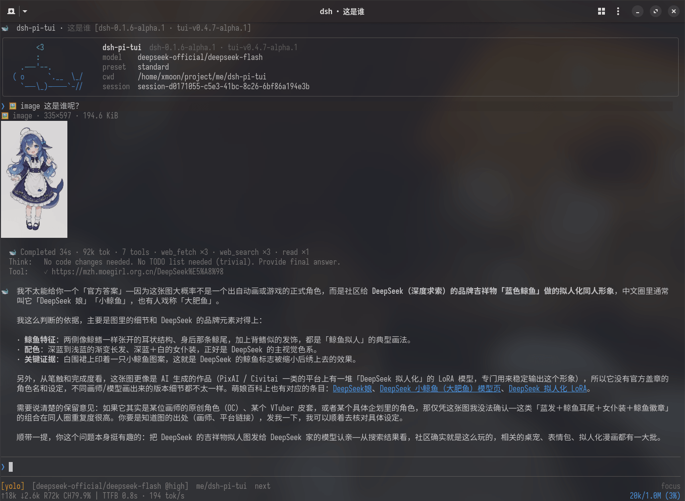
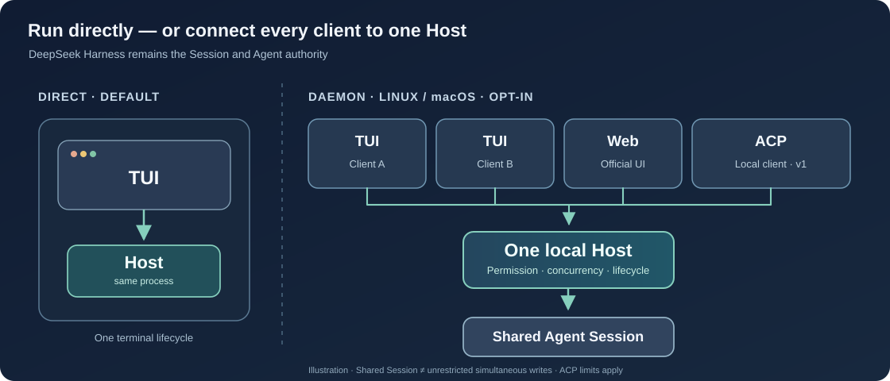

# dsh-pi-tui

English | [简体中文](README.md)

**A terminal frontend for DeepSeek Harness. One Host, with TUI, Web and ACP clients accessing the same Agent Session.**

**Direct** remains the default, ready-to-use mode. Starting in the published **0.5.8**, Linux and macOS users can explicitly choose a **Daemon**. The **current main line (not yet in the published 0.5.8 npm release)** extends the same Daemon mode to native Windows 11 x64: an independent local Host retains sessions and ongoing work as terminal Clients disconnect and reconnect. Other TUIs, the official Web frontend and an opt-in local ACP client can access sessions belonging to that same Host.

[DeepSeek Harness](https://github.com/deepseek-ai/deepseek-harness) remains the authority for the Agent Loop, models, tools, persistence, permissions and concurrent writes. `dsh-pi-tui` is a third-party frontend, not a second Agent Runtime.

> **Shared Sessions, not shared terminal screens.** Multiple TUI clients can view the same Session; Web and ACP use the Host's official Session/Agent capabilities. Prompt admission, approvals, cancellation and writes remain subject to Host permission and concurrency rules. ACP permits at most one ACP View per Session at a time (without limiting TUI Views), and ACP v1 is a bounded protocol subset. Daemon access is **local, same-OS-user** functionality, not a public TCP remote service.

## Install into a DSH profile

### Stable / latest

**0.5.8 is the current stable release (npm `@latest`).** The recommended DSH pairing is **0.2.2-rc.5**. Install DeepSeek Harness first, then the TUI bundle into the `pi-tui` profile:

~~~sh
npm install -g --allow-scripts=@deepseek-ai/dsh-subprocess-local,koffi,node-pty @deepseek-ai/dsh@0.2.2-rc.5
dsh plugin --profile pi-tui -- add @xmoon76/dsh-pi-tui@latest
dsh --profile pi-tui
~~~

### Exact version pairing (0.5.8)

**0.5.8 requires Node.js ≥24.9.0 and DSH ≥0.2.2-rc.3. DSH 0.2.2-rc.5 is recommended** (the exact qualification target for this release). For a reproducible installation, pin both package versions:

~~~sh
npm install -g --allow-scripts=@deepseek-ai/dsh-subprocess-local,koffi,node-pty @deepseek-ai/dsh@0.2.2-rc.5
dsh plugin --profile pi-tui -- add @xmoon76/dsh-pi-tui@0.5.8
dsh --profile pi-tui
~~~

| TUI | DSH | Status |
|---|---|---|
| `0.5.8` | `>=0.2.2-rc.3`; recommended `0.2.2-rc.5` | **Current latest** |
| `0.5.6` | `0.2.2-rc.1` | Previous release |

**Fresh 0.5.8 install:** The DSH plugin command above installs the TUI without manually adding `@deepseek-ai/dsh-client-store`, `zustand` or `immer`. A failed Daemon Client startup reports its own `$DSH_HOME/logs/pi-tui-client/startup-*.log` file; `daemon logs` covers Host logs only.

**Upgrade precaution:** Before changing the DSH Runtime, finish in-flight Turns/Jobs, stop the previous Host and back up Profiles, Sessions and required data. Cross-DSH schema downgrade in place is not guaranteed. Do not pair 0.5.8 with rc.2 or earlier. See the [compatibility guide](docs/guides/dsh-compatibility.md) for historical pairs and recovery.

### Next / npm line (validation)

The TUI `@next` channel and DSH `@alpha` channel are independent moving pointers. Verify their actual published versions and peer/engine ranges before combining them:

~~~sh
npm install -g --allow-scripts=@deepseek-ai/dsh-subprocess-local,koffi,node-pty @deepseek-ai/dsh@alpha
dsh plugin --profile pi-tui -- add @xmoon76/dsh-pi-tui@next
dsh --profile pi-tui
~~~

## Features

### Two modes, one DSH Session authority

| | Direct (default) | Daemon (opt-in from 0.5.8 on Linux/macOS; Windows current main candidate) |
|---|---|---|
| Launch | `dsh --profile pi-tui` | `DSH_PI_TUI_BACKEND=daemon dsh --profile pi-tui` (PowerShell: `$env:DSH_PI_TUI_BACKEND='daemon'; dsh --profile pi-tui`) |
| Process | TUI and Host in one process | Independent Host; TUI is a detachable Client |
| Frontends | Current in-process terminal surface | Multiple TUIs + official Web + optional local ACP on one Host/Session |
| Exit | Ends the Direct application | Normally detaches only the Client; does not stop Host |
| Service | No separate management | Optional Linux systemd --user / macOS LaunchAgent |

You can also save `Daemon` under `/settings → Host → Backend` for the **next cold launch**. `DSH_PI_TUI_BACKEND` overrides that preference for one launch without saving it. Selecting a backend does not hot-migrate a Host. Installing an OS user service is optional, not a prerequisite. Sessions and Agents remain Host-owned.

### Agents, tasks and sessions

- **Agent and tools:** streamed Markdown, Thinking / Tool / Context disclosure, approvals and Questions, model/reasoning-effort selection, Plan, Goal and Todo.
- **Sessions and workspaces:** `/sessions`, `/new`, `/resume`, `/fork`, `/rewind`, `--session` and `--continue`; browse by workspace and preview before resuming.
- **Team / Subagent / Job:** toggle Root Agent Team in `/model`; `/tasks` displays Work/Team, nested Subagents and Jobs. Subagents are expanded by default; retained Job history is optionally disclosed.
- **Presets:** bare `/preset` opens a two-page Catalog + Details surface — search, Built-in/Custom groups and state chips; browsing and reading Details never write. Only the explicit bottom actions `Use next` / `Use session` and `Set default` apply a preset or save the new-session default. `/preset status`, `/preset default [<id>]` and `/preset <id>` remain available.
- **Input and shell:** `@file` completion, image and file attachments, `Ctrl+V` image paste, `!` / `!!` Host Shell, external editor, customizable Footer. On Windows Direct and Daemon, `!` / `!!` run on the Host with the official PowerShell shell (the Windows Daemon is a current-main candidate); the sandbox uses DSH's ACL backend with partial enforcement, and native command/variable/git completion is unavailable (ordinary path completion remains).
- **Reading and search:** `/display` Full / Focus / Compact, Transcript View / Full search, folding, `Ctrl+R` prompt history. Current Session recall spans working-directory changes.
- **Settings and plugins:** Provider authorization/credentials, approvals, MCP management, Web Search/Fetch, Plugin Manager, dynamic Extension Settings and Client-local `./tui` plugin loading.
- **Images and delivery:** terminal-gated image/static SVG/charts, `/view-image`, `/deliverables`, `/export`; Kitty, SIXEL and supported iTerm2 paths.
- **Optional experimental renderer:** `DSH_PI_TUI_RENDERER=tsp` enables a subset of Tern TSP native Transcript/Work Hub interactions; it does not replace every PiTui Settings/Plugins surface.

### Useful commands and default keys

| Command / key | Use |
|---|---|
| `/sessions` · `/resume` · `/new` | Find or start sessions |
| `/model` · `/tasks` · `/plan` · `/goal` | Models, jobs and Agent modes |
| `/preset` | Browse/apply a session preset or save the new-session default |
| `/settings` · `/plugins` · `/keybindings` | Configuration and extensions |
| `/display` · `/export` · `/deliverables` | Reading and exporting |
| `Ctrl+F` · `Ctrl+Shift+F` | Rendered-view / available Session-history search |
| `Ctrl+R` · `Ctrl+G` | Prompt history / external editor |
| `Ctrl+O` · `Alt+T` | Tool/Context and Thinking disclosure |
| `Ctrl+C` · `Ctrl+D` | Cancel while busy, or follow idle exit confirmation |
| `!` · `!!` | Host Shell with / without Session persistence |

These are default mappings and common entries; `/keybindings` shows the **effective** keys after customizations. Type `/` to search and select commands and available Skills; use `/skill <name> [args]` to invoke a Skill explicitly (including when a same-named command would otherwise win), while bare `/skill` only prints its usage. `/transcript` currently uses the official Direct Markdown export; `/export` creates a separate ZIP archive saved on the Client filesystem. `PI_IMAGE_PROTOCOL=none` disables pixel previews, not attachments.

## Daemon quick start (Linux / macOS / native Windows 11 x64)

> The Windows interactive Daemon Client is a current-main candidate and is not yet in the published 0.5.8 npm release.

A system service is not required to start a standalone Host. Try one launch (the interactive Daemon Client supports Linux/macOS and native Windows 11 x64 ordinary users on a local fixed-NTFS Profile):

~~~sh
DSH_PI_TUI_BACKEND=daemon dsh --profile pi-tui
~~~

The usual Daemon TUI `/exit` / `/quit` **detaches the Client, not the Host**. When the current Session is working, the TUI offers explicit exit choices. Management commands operate only on the selected Profile:

~~~sh
dsh --profile pi-tui daemon status
dsh --profile pi-tui daemon logs --lines 200
dsh --profile pi-tui daemon start
dsh --profile pi-tui daemon stop
dsh --profile pi-tui daemon restart
dsh --profile pi-tui daemon install   # Linux / macOS only
dsh --profile pi-tui daemon uninstall # Linux / macOS only
~~~

On Windows the **current main line (not yet in the published 0.5.8 npm release)** supports the independent Host, the interactive Daemon Client, `status`, `start`, `stop`, `restart`, `logs` and the official Web frontend. `install`/`uninstall` and ACP remain unavailable. `/reload-client` is not available on Windows: it refuses before any reload starts and keeps the current Client/Session/draft; exit with `/exit` and relaunch to adopt an updated build. Windows `status` reports `manager=process` for an authenticated Host and `manager=unmanaged` with no Host; `unit=none`, and it never invokes systemd/launchd; `stop` enters the official shutdown through that instance's native stop Event.

`daemon install` only creates/verifies the optional Profile-scoped OS user service definition; it does **not** start, enable or migrate the Host. `daemon stop` and `restart` can interrupt in-flight Turns/Jobs across connected Clients. A manager reporting “running” is not proof of authenticated Host readiness.

Within the **same DSH Runtime and Profile**, update the installed TUI bundle through official plugin management. The old Host may continue serving existing work; explicitly run `daemon restart` when you want its static code replaced (with an interruption). Same-Profile older service definitions do not require a routine uninstall first. **Changing DSH Runtime** is not a hot upgrade; stop, back up and cold start a supported pair. See the [Daemon guide](docs/guides/daemon.md).

## Web, ACP and other clients share the Host Session

The **official Web frontend** and optional local ACP listener use the same Daemon Host and its official Session/Agent authority. The Web frontend is default-off and can be enabled on a running Host:

~~~sh
dsh --profile pi-tui web enable
dsh --profile pi-tui web url
dsh --profile pi-tui web status
~~~

Also available: `web disable` / `web open`. The commands do **not** start a Host or create a Session. The `web url` output contains an authentication token: handle it as a secret. The official Web page lets users select sessions held by that Host.

In a connected Daemon TUI, `/web` opens **`Settings → Host → Web UI`** directly: the same page shows the running Host's live state and actions (Open in browser / Copy access link / Enable / Disable, with a confirmation before disabling) and the `Start automatically` preference that applies **only to the next Host start**. Neither changes the other, and the launch link is read only by an explicit Open/Copy and never painted.

In a connected Daemon TUI, `/acp` opens **`Settings → Host → ACP access`** directly: the same page shows the running Host's local ACP listener state (Enabled / Disabled / Changing / Unavailable; on Direct it states `Unavailable · Split Host only`), `Enable ACP` and a two-step-confirmed `Disable ACP…`, `Copy client command` — the exact `dsh --profile … acp stdio` command of the proven Profile, read only by that explicit copy — the `Start automatically` preference that applies **only to the next Host start**, and the `Client Setup` guidance. The runtime state and the next-start preference are separate authorities: toggling the running Host never changes the preference, saving the preference never starts or stops the current listener, and leaving the page or the TUI never undoes an accepted Host change.

**ACP v1** is a default-off, same-user local interface. An external ACP client joins through the current Profile's public `dsh --profile pi-tui acp stdio` command: it relays that client's stdio to the existing Host's local ACP listener. It creates **no** second Host, Agent, Session or Writer and never starts the Host or enables the listener by itself. It is the stdio command you configure in an ACP client, not a command whose interactive terminal is expected to show a TUI.

The listener's runtime state can also be read and toggled without opening a TUI (these commands never start a Host either):

~~~sh
dsh --profile pi-tui acp status
dsh --profile pi-tui acp enable
dsh --profile pi-tui acp disable
~~~

`acp status` is read-only and prints one `acp=enabled|disabled|changing|unavailable` line; `acp enable` / `acp disable` send exactly one write and print the state the Host actually reached — a `changing` state or a lost response is never guessed as success. They manage only the running Host of the current Profile: they do not change the next-launch `autoStart`, do not stop the Host/Agent/Session/TUI, and `disable` closes existing ACP peers and stops accepting new ones.

Preparation: start and confirm the Host, then switch the listener to **Enabled** from a connected Daemon TUI with `/acp` (or with the headless `acp enable`) — its next-start-only `Start automatically` preference lives in `/settings → Host → ACP access` — confirm `acp=enabled` with `daemon status` or `acp status`, and only then put the command into the external ACP client's stdio command configuration:

~~~sh
dsh --profile pi-tui daemon start
dsh --profile pi-tui daemon status        # host=ready, acp=enabled
# In the external ACP client's stdio command configuration:
dsh --profile pi-tui acp stdio
~~~

The trusted default Profile keeps that command's stdout to ACP protocol bytes; a third-party plugin that writes stdout during early startup can still pollute it (an accepted deployment constraint). Local ACP supports `initialize`, `session/new|resume|load|list|prompt|cancel|close`, capability-negotiated images, and **Agent-scoped stdio and Streamable HTTP** MCP servers declared by the client in `session/new|resume|load` (at most 4 stdio/HTTP servers in aggregate per Session). One ACP connection may hold **up to eight** Session Views; a Host Session is held by at most one ACP connection at a time, with no such limit on TUI Views. HTTP here means only the MCP server's Streamable HTTP transport; ACP itself remains the same-UID local Unix socket, not a network listener. It provides **no** Host-wide MCP server management and does not support Legacy SSE (no official DSH transport), `session/delete`/`fork` or unproven file transfer. This remains **Limited ACP v1**, not a full ACP v1. See [the external ACP client section of the Daemon guide](docs/guides/daemon.md#external-acp-client-over-stdio); the direct SDK connection example remains advanced usage in the [ACP v1 SDK example](docs/guides/daemon.md#local-acp-v1-sdk-client-example).

> **Release boundary:** `acp stdio` and `acp status|enable|disable` belong to the current `main` candidate implementation. The published **v0.5.8** release files do **not** contain these new entries, so the “0.5.8 installation” section above is not an installation guarantee for these commands. Shipping them to npm `@latest` needs an independent future release; verify the version you actually installed with `dsh --profile pi-tui acp --help`.

When launched inside [Herdr](https://github.com/herdrdev/herdr), the TUI can report Agent status and provide Profile-pinned recovery commands for durable Sessions where the Herdr Client supports them.

Terminals that implement the [OSC 7577 Program Resume Protocol v0.5](https://www.superlogical.com/rex/docs/build/program-resume), such as Rex, receive a Client-local resume record when the terminal injects `OSC7577_TOKEN`. Direct and Daemon both derive the exact resume command from the committed main Session; a Daemon record uses the stable supervisor PID, so Client replacement keeps the record identity. A normal human exit clears the record; signals, terminal loss, crashes and HMR do not, a compatible Client reload keeps it, and only an accepted reload to an older target without the handoff withdraws it. The token never enters argv, a Session or logs, and is never passed to a separate Host/manager/ACP child process; Direct's same-process official launch snapshot retains the inherited value under the same-UID trust boundary. The terminal sends no ACK. **Real Rex acceptance/restore is not yet verified** in this release.

## Settings, extensions and development

`/settings` is the shared fullscreen Settings workspace; `/plugins`, `/footer` and `/keybindings` open its relevant pages. `/keybindings conflicts` opens the same Keyboard shortcuts page directly in its Conflicts view; when the settings document cannot be read or that page cannot open, the command returns an error carrying the current conflict diagnostics. Host configuration writes use official authoritative readback; a package enabled in the Host is not necessarily an ACTIVE `./tui` extension in the current Client.

Public extensions have **Stable / Advanced / Unstable** tiers: see the [authoring guide](docs/extensions/authoring.md), [Stable API](docs/extensions/stable.md) and [tier contract](docs/extensions/tiers.md). Version 0.5.8 adds Client-local `./tui` loading and per-package persisted settings, but **does not deliver Forge or a Plugin Marketplace**.

For development:

~~~sh
mise install --locked
mise run setup
mise run build
mise run typecheck
~~~

Read [AGENTS.md](AGENTS.md), the [development guide](docs/guides/development.md) and [documentation index](docs/README.md). The [release checklist](docs/guides/releasing.md) owns full release verification.

## Changelog and license

- [中文 CHANGELOG](CHANGELOG.md) / [English CHANGELOG](CHANGELOG.en.md)
- [MIT License](LICENSE)
