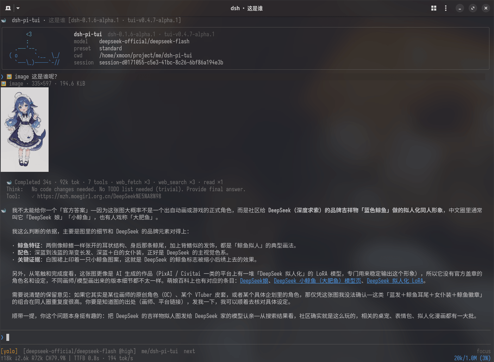
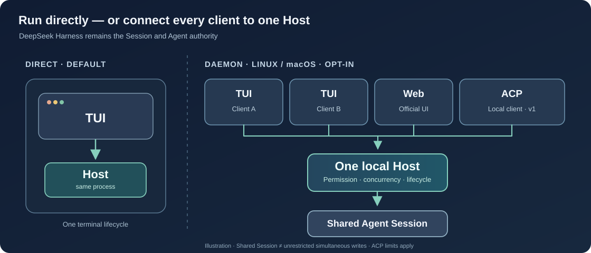

# dsh-pi-tui

[English](README.en.md) | 简体中文

**面向 DeepSeek Harness 的终端交互界面；一个 Host，让终端、Web 和 ACP 客户端访问同一个 Agent Session。**

默认以 **Direct** 模式运行，开箱即用；从 **0.5.8** 起，可在 Linux/macOS 显式选择 **Daemon**：独立的本地 Host 持有 Session 和执行中的工作，终端 Client 可以断开、重新连接；其他 TUI、官方 Web 与本地 ACP 客户端也可以访问同一 Host 的会话。

Agent Loop、模型、工具、持久化、权限和并发写入权威都属于 [DeepSeek Harness](https://github.com/deepseek-ai/deepseek-harness)；`dsh-pi-tui` 是第三方前端，而不是另一套 Agent Runtime。

> **核心能力：多入口共享会话，不是共享终端画面。** 多个 TUI 客户端可以查看同一 Session，Web 和 ACP 使用该 Host 的官方 Session/Agent 能力；提交、审批、取消和 Session 写入仍受 Host 的权限与并发控制。ACP 同一 Session 同时最多一个 ACP View（不限制 TUI View），且 ACP v1 只提供受限协议子集。Daemon 属于**同机、本地用户**能力，不直接暴露公共 TCP 远程服务。

## 安装到 DSH Profile

### Stable / latest

**0.5.8 是当前最新稳定版（npm `@latest`）**。推荐搭配 **DSH 0.2.2-rc.5**；先安装 DeepSeek Harness，再将 TUI 添加到 `pi-tui` Profile：

~~~sh
npm install -g --allow-scripts=@deepseek-ai/dsh-subprocess-local,koffi,node-pty @deepseek-ai/dsh@0.2.2-rc.5
dsh plugin --profile pi-tui -- add @xmoon76/dsh-pi-tui@latest
dsh --profile pi-tui
~~~

### 精确版本配对（0.5.8）

**0.5.8 要求 Node.js ≥24.9.0、DSH ≥0.2.2-rc.3，推荐使用 DSH 0.2.2-rc.5**（本版本的精确验证目标）。需要可复现安装时，固定两个包的版本：

~~~sh
npm install -g --allow-scripts=@deepseek-ai/dsh-subprocess-local,koffi,node-pty @deepseek-ai/dsh@0.2.2-rc.5
dsh plugin --profile pi-tui -- add @xmoon76/dsh-pi-tui@0.5.8
dsh --profile pi-tui
~~~

| TUI | DSH | 状态 |
|---|---|---|
| `0.5.8` | `>=0.2.2-rc.3`；推荐 `0.2.2-rc.5` | **当前 latest** |
| `0.5.6` | `0.2.2-rc.1` | 上一版本 |

**0.5.8 干净安装**：只需执行上面的 DSH 插件安装命令，不需要手动安装 `@deepseek-ai/dsh-client-store`、`zustand` 或 `immer`。Daemon Client 自身启动失败时会提供 `$DSH_HOME/logs/pi-tui-client/startup-*.log` 诊断文件位置；`daemon logs` 仅查看 Host 日志。

**升级注意**：跨 DSH Runtime 升级必须先完成正在运行的 Turn/Job、停止旧 Host 并备份 Profile、Session 与所需数据；不保证跨 DSH 数据 Schema 的原地回退。不要将 0.5.8 配到 DSH rc.2 或更早版本。完整配对和恢复方法见[兼容性指南](docs/guides/dsh-compatibility.md)。

### Next / npm 线（验证）

`@next` 与 DSH `@alpha` 是独立移动的验证渠道，不承诺始终互相兼容；安装前确认实际版本及 peer/engine 范围：

~~~sh
npm install -g --allow-scripts=@deepseek-ai/dsh-subprocess-local,koffi,node-pty @deepseek-ai/dsh@alpha
dsh plugin --profile pi-tui -- add @xmoon76/dsh-pi-tui@next
dsh --profile pi-tui
~~~

## 功能

### 两种运行方式，同一套 DSH 会话语义

| | Direct（默认） | Daemon（0.5.8 起，可选） |
|---|---|---|
| 启动 | `dsh --profile pi-tui` | `DSH_PI_TUI_BACKEND=daemon dsh --profile pi-tui` |
| 进程 | TUI 与 Host 同进程 | Host 独立运行，TUI 是可断开的 Client |
| 多入口 | 当前进程内的交互界面 | 多个 TUI + 官方 Web + 可选本地 ACP 访问同一 Host/Session |
| 退出 | 结束 Direct 程序 | 默认仅断开 Client，Host 不因此自动停止 |
| 系统服务 | 无需额外管理 | Linux systemd --user / macOS LaunchAgent **可选安装** |

Daemon 的选择也可以在 `/settings → Host → Backend` 保存，**下一次冷启动**生效；`DSH_PI_TUI_BACKEND` 仅覆盖本次启动、不写回设置。安装系统服务不是 Daemon 的前提，切换后端也不会热迁移 Host。所有实例仍由同一 Profile 和 DSH 官方 Session/Agent 权威管理。

### Agent、任务与会话

- **Agent 与工具**：流式 Markdown、Thinking / Tool / Context 展开、审批与 Question、模型与 Reasoning Effort、Plan、Goal 和 Todo。
- **Session 与 Workspace**：`/sessions` 浏览工作区与会话；`/new`、`/resume`、`/fork`、`/rewind`、`--session` 和 `--continue`；可只读预览后再选择恢复。
- **Team / Subagent / Job**：`/model` 可控制 Root Agent Team；`/tasks` 显示 Work/Team、嵌套 Subagent 和 Job。Subagent 默认展开，已完成的 Job 历史可以按需展开。
- **Preset**：裸 `/preset` 打开两页 Catalog + Details——搜索、Built-in/Custom 分组与状态标记，阅读与打开详情不会写入；只有底部的 `Use next` / `Use session` 和 `Set default` 显式动作才会应用预设或保存新会话默认值。`/preset status`、`/preset default [<id>]` 与 `/preset <id>` 保留。
- **输入与终端操作**：`@file` 补全、图片/普通文件附件、`Ctrl+V` 图片粘贴、`!` 和 `!!` Shell、外部编辑器和可编辑的 Footer。Windows Direct 下 `!`/`!!` 使用官方 PowerShell；sandbox 使用 DSH ACL 后端（partial enforcement），且没有原生命令/变量补全（普通路径补全保留）。
- **阅读与搜索**：`/display` 切换 Full / Focus / Compact；Transcript View / Full 搜索、卡片折叠、`Ctrl+R` 历史输入召回。Current session 历史可跨工作目录读取同一 Session 的历史记录。
- **Settings / 插件**：Provider 登录和凭据、审批、MCP Server 管理、Web Search/Fetch、Plugin Manager、动态 Extension Settings，以及 Client-local `./tui` 扩展加载。
- **图像与交付**：受终端能力约束的图片、静态 SVG、图表、`/view-image`、`/deliverables`、`/export`；支持 Kitty、SIXEL 和受支持的 iTerm2 图像路径。
- **可选实验渲染器**：`DSH_PI_TUI_RENDERER=tsp` 使用 Tern TSP，提供部分原生 Transcript/Work Hub 体验；不是所有 PiTui Settings/Plugins 的替代品。

### 常用命令和快捷键

| 入口 | 用途 |
|---|---|
| `/sessions` · `/resume` · `/new` | 找回或开始会话 |
| `/model` · `/tasks` · `/plan` · `/goal` | 模型、任务和 Agent 工作模式 |
| `/preset` | 浏览、应用会话预设或保存新会话默认值 |
| `/settings` · `/plugins` · `/keybindings` | 配置与扩展 |
| `/display` · `/export` · `/deliverables` | 阅读与导出 |
| `Ctrl+F` · `Ctrl+Shift+F` | 已绘制文本 / 可用 Session 历史搜索 |
| `Ctrl+R` · `Ctrl+G` | 历史输入 / 外部编辑器 |
| `Ctrl+O` · `Alt+T` | Tool / Context 与 Thinking 折叠 |
| `Ctrl+C` · `Ctrl+D` | 工作中取消、或空闲时遵循实际键位/确认退出 |
| `!` · `!!` | Host Shell：结果入 Session / 不入 Session |

这里列出的是默认键位和常见入口；自定义后以 `/keybindings` 显示的**实际生效键位**为准。输入 `/` 可搜索并选择命令与可用的 Skills；需要显式调用某个 Skill（包括与同名命令冲突时）使用 `/skill <name> [args]`，裸 `/skill` 只显示用法。`/transcript` 当前的官方 Markdown 导出路径属于 Direct；`/export` 是独立的 ZIP 归档，产物落在 Client 本地目录。`PI_IMAGE_PROTOCOL=none` 只禁止像素预览，不影响附件发送。

## Daemon 快速上手（Linux / macOS）

不安装系统服务也可以启动独立 Host。一次性体验：

~~~sh
DSH_PI_TUI_BACKEND=daemon dsh --profile pi-tui
~~~

离开 Daemon TUI 的普通 `/exit`（或 `/quit`）只断开 Client，**不等于停止 Host**。当前 Session 正在工作时会出现明确的退出选择；如果你选择继续运行并断开，Host 工作仍由 Host 管理。管理命令只影响指定 Profile：

~~~sh
dsh --profile pi-tui daemon status
dsh --profile pi-tui daemon logs --lines 200
dsh --profile pi-tui daemon start
dsh --profile pi-tui daemon stop
dsh --profile pi-tui daemon restart
dsh --profile pi-tui daemon install
dsh --profile pi-tui daemon uninstall
~~~

`daemon install` 仅选择性地创建/验证当前 Profile 的用户服务定义，**不会**自动启动、启用或迁移 Host。`daemon stop` / `restart` 可能中断所有连接 Client 的进行中 Turn/Job；manager 显示运行中不代表 Host 已 Ready，须以认证身份确认。

同一 **DSH Runtime + Profile** 下，先通过官方插件命令更新 TUI；旧 Host 可以继续提供服务。需要让 Host 采用新包的代码时，再显式 `daemon restart`（会中断在途工作）；无需为同 Profile 的旧安装构建例行先卸载服务定义。**更换 DSH Runtime** 则不是热升级，必须走停止、备份和冷启动流程。详见 [Daemon 用户指南](docs/guides/daemon.md)。

## Web、ACP 和其他客户端：共同访问 Host Session

**官方 Web** 与本地 ACP 不是另一台 Host，也不是另一份 Session 记录。它们与 Daemon TUI 同样使用当前 Profile 的 Host Authority。Web 默认关闭，可在已运行 Host 上显式开启：

~~~sh
dsh --profile pi-tui web enable
dsh --profile pi-tui web url
dsh --profile pi-tui web status
~~~

还可使用 `web disable` / `web open`。这些命令**不会启动 Host**，也不会自动创建 Session；`web url` 输出的地址含认证 Token，必须作为敏感凭据处理。官方 Web 页面选择/打开 Session，并与 TUI 访问同一 Host 数据。

已连接的 Daemon TUI 里，`/web` 直接打开 **`Settings → Host → Web UI`** 页面：同一页面分别展示**当前 Host** 的实时状态与操作（Open in browser / Copy access link / Enable / Disable，关闭前需二次确认），以及**只对下次 Host 启动生效**的 `Start automatically` 偏好。两者不会互相改变；链接只在显式 Open/Copy 时读取，从不显示在界面上。

已连接的 Daemon TUI 里，`/acp` 直接打开 **`Settings → Host → ACP access`** 页面：同一页面展示**当前 Host** 的本地 ACP Listener 实时状态（监听中 / 未监听 / 切换中 / 不可用，Direct 下明确为 `Unavailable · Split Host only`）、`Enable ACP` 与需二次确认的 `Disable ACP…`、只在显式复制时才读取的 `Copy client command`（即当前已证 Profile 的 `dsh --profile … acp stdio`），以及**只对下次 Host 启动生效**的 `Start automatically` 偏好和 `Client Setup` 接入说明。运行状态与下次启动偏好是两个独立权威：开关当前 Host 不会改动偏好，保存偏好也不会启停当前 Listener；退出页面或断开 TUI 不会撤销已生效的 Host 变更。

**ACP v1** 是默认关闭的、同机同用户本地接口。外部 ACP 客户端通过当前安装 Profile 的官方命令 `dsh --profile pi-tui acp stdio` 接入：它把该客户端的 stdio 原样转发给现有 Host 的本地 ACP Listener，**不会**另建 Host、Agent、Session 或 Writer，也**不会**自动启动 Host 或启用 Listener。它是填给 ACP 客户端的 stdio command，不是让用户在交互终端里期待 TUI 画面的命令。

Listener 的运行状态也可以用不打开 TUI 的 headless 命令读取和切换（同样**不会启动 Host**）：

~~~sh
dsh --profile pi-tui acp status
dsh --profile pi-tui acp enable
dsh --profile pi-tui acp disable
~~~

`acp status` 只读，输出一行 `acp=enabled|disabled|changing|unavailable`；`acp enable` / `acp disable` 只发送一次写入并打印 Host 真实达到的状态——`changing` 或响应丢失不会被猜成成功。它们只管理**当前 Profile 已运行 Host** 的运行时 Listener，不改变下次冷启动的 `autoStart`，也不会停止 Host、Agent、Session 或 TUI；`disable` 会断开已有 ACP 连接并停止接受新连接。

准备步骤：先启动并确认 Host，再从已连接的 Daemon TUI 用 `/acp`（或 headless 的 `acp enable`）把 Listener 切到 **Enabled**（`/settings → Host → ACP access` 里的 `Start automatically` 只控制下次 Host 冷启动），用 `daemon status` 或 `acp status` 确认 `acp=enabled`，然后才在外部 ACP 客户端的 stdio command 配置里填写该命令：

~~~sh
dsh --profile pi-tui daemon start
dsh --profile pi-tui daemon status        # 确认 host=ready、acp=enabled
# 在外部 ACP 客户端的 stdio command 配置中：
dsh --profile pi-tui acp stdio
~~~

受信默认 Profile 保证该命令的 stdout 只承载 ACP 协议字节；第三方插件若在早期启动阶段直接写 stdout，仍可能污染它（属于接受的部署约束）。本地 ACP 支持 `initialize`、`session/new|resume|load|list|prompt|cancel|close`、能力协商后的图片输入，以及客户端在 `session/new|resume|load` 中声明的 **Agent-scoped stdio 与 Streamable HTTP** MCP Server（stdio 与 HTTP 合计每个 Session 最多 4 个）。一条 ACP 连接可持有**至多 8 个**不同 Session 的 View；同一 Host Session 同时只由一条 ACP 连接持有 View，而多个 TUI 不受此限制。这里的 HTTP 仅指 MCP Server 的 Streamable HTTP 传输；ACP 本身仍是同 UID 本地 Unix socket，不是网络监听。它**不**提供 Host 级 MCP Server 管理，也不支持 Legacy SSE（无官方 DSH transport）、`session/delete`/`fork` 或未证明的文件传输，仍是 **Limited ACP v1**，不等于完整 ACP v1。接入步骤见 [Daemon 指南的外部 ACP 客户端章节](docs/guides/daemon.md#external-acp-client-over-stdio)；直接使用 SDK 连接 Listener 的例子仍作为高级用法保留在 [ACP v1 SDK 例子](docs/guides/daemon.md#local-acp-v1-sdk-client-example)。

> **发行边界：** `acp stdio` 与 `acp status|enable|disable` 属于当前 `main` 的候选实现；已发布的 **v0.5.8** 发行文件**不包含**这些新入口，因此上文“0.5.8 安装”段落不能作为这些命令可用的安装保证。它们进入 npm `@latest` 需要独立的后续发行；请对实际安装的版本运行 `dsh --profile pi-tui acp --help` 确认。

在 [Herdr](https://github.com/herdrdev/herdr) Pane 中运行时，TUI 可以上报 Agent 工作状态；对有持久 Session ID 的场景可提供经 Profile 约束的恢复命令，实际能力取决于 Herdr 客户端。

支持 [OSC 7577 Program Resume Protocol v0.5](https://www.superlogical.com/rex/docs/build/program-resume) 的终端（例如 Rex）会在终端注入 `OSC7577_TOKEN` 时收到 Client-local 的恢复记录。Direct 与 Daemon 都只从已提交的主 Session 生成精确恢复命令；Daemon 记录使用稳定的 supervisor PID，Client 替换不会改变记录身份。普通人工退出会撤销记录；信号、终端丢失、崩溃与 HMR 不撤销；兼容的 Client reload 会继续记录，只有接受 reload 到不支持新交接的旧版时才撤销。Token 不会进入 argv、Session 或日志，也不会传给独立的 Host/manager/ACP 子进程；Direct 同进程内的官方 launch snapshot 仍按 same-UID 可信边界保留继承值。终端不发送 ACK，本版本**尚未验证真实 Rex 的接受/恢复结果**。

## 设置、扩展与开发

`/settings` 是统一的全屏设置入口；`/plugins`、`/footer`、`/keybindings` 是对应页面的快捷入口。`/keybindings conflicts` 直接进入同一个 Keyboard shortcuts 页面的 Conflicts 视图；设置文档不可读或该页面无法打开时，命令返回包含当前冲突诊断的错误。Host 配置写入会经过官方回读确认；当前 Client 的插件 `./tui` 激活状态与 Host 包是否启用是不同事实。

扩展按 **Stable / Advanced / Unstable** 三层发布，详见 [扩展作者指南](docs/extensions/authoring.md)、[Stable API](docs/extensions/stable.md) 和 [兼容性分层](docs/extensions/tiers.md)。0.5.8 增加了 Client-local `./tui` 加载与按包持久设置，但**不代表 Forge 或 Plugin Marketplace 已交付**。

从源码开发：

~~~sh
mise install --locked
mise run setup
mise run build
mise run typecheck
~~~

请先阅读 [AGENTS.md](AGENTS.md)、[开发指南](docs/guides/development.md) 与[文档索引](docs/README.md)；完整发布与验证步骤见 [Release checklist](docs/guides/releasing.md)。

## 更新日志与许可证

- [中文 CHANGELOG](CHANGELOG.md) / [English CHANGELOG](CHANGELOG.en.md)
- [MIT License](LICENSE)
